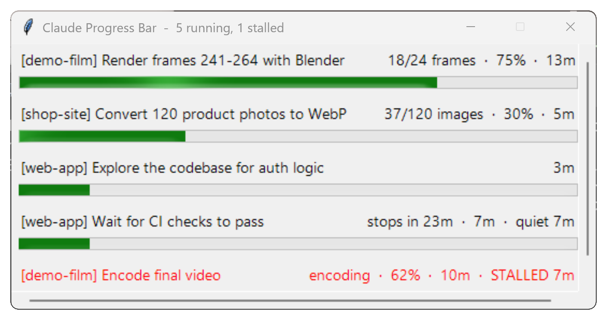

# Claude Progress Bar

A small Windows window that shows **one live bar for every task Claude Code is running in the background**, across all your sessions at once, and warns you when one goes quiet.

- Background shell commands (`run_in_background`, or commands Claude moved to the background)
- Subagents, named the same way as in Claude Code's Background tasks panel
- Foreground commands that run longer than 10 seconds
- Long jobs you register yourself (renders, ffmpeg, scripts) with a real percentage

<!--  -->

## What the colours mean

| State | Bar | Tray icon |
| --- | --- | --- |
| Running, output still changing | black text | green |
| No activity for 2 minutes | amber | amber |
| No activity for 5 minutes: probably stalled | **red + alert sound + taskbar flash** | red |
| Finished | green | |
| Failed, or the process died | dark red | |
| Nothing running (still listening) | window hidden | grey |

Right-click a row to copy a ready-made message for Claude ("Please check whether this task is still making progress or has stalled: …") or the task's log path, or to dismiss the bar.

The window hides itself when nothing is running and comes back when a new task starts. Closing it with **X** only hides it; to quit, right-click the tray icon and choose **Exit** (it restarts with the next Claude task).

## Requirements

- **Windows 10 or 11** (macOS and Linux are not supported yet; on those the plugin installs but does nothing)
- **Claude Code** (CLI, desktop app or IDE extension)
- **Python 3** available as `python` on your PATH
- PowerShell 7 (`pwsh`) is used if installed; otherwise the built-in Windows PowerShell 5.1

## Install (as a Claude Code plugin)

In Claude Code, run:

```
/plugin marketplace add wilsonnjanjo-cloud/claude-progress-bar
/plugin install claude-progress-bar@claude-progress-bar
```

Restart Claude Code (or start a new session). The window appears the first time Claude starts a background task or a subagent.

### Manual install (without the plugin system)

1. Download this repository (green **Code** button, **Download ZIP**) and unzip it somewhere permanent, for example `C:\Tools\claude-progress-bar`.
2. Add the hooks from [`hooks/hooks.json`](hooks/hooks.json) to the `"hooks"` section of `%USERPROFILE%\.claude\settings.json`, replacing `${CLAUDE_PLUGIN_ROOT}` with the folder you unzipped to (use forward slashes, e.g. `C:/Tools/claude-progress-bar`).

### Start it at Windows logon (optional)

The hooks start the window automatically. If you also want the tray icon from the moment you log in, copy the shortcut the plugin creates into your Startup folder (run once, in PowerShell, after the window has appeared at least once):

```powershell
Copy-Item "$env:LOCALAPPDATA\ClaudeProgressBar\Claude Progress Bar.lnk" "$env:APPDATA\Microsoft\Windows\Start Menu\Programs\Startup\"
```

## Tracking your own long jobs

`scripts/progress_job.ps1` adds a bar with a real percentage for any job that writes a progress file:

```powershell
# ffmpeg run with:  ffmpeg ... -progress C:\work\prog.txt
pwsh -File scripts\progress_job.ps1 -Name "Final render" -Kind ffmpeg -Log C:\work\prog.txt -Total 1051 -ProcessId 1234

# any script that writes "NN|text" or "NN% text" lines (e.g. "42% (80/192 frames)"),
# ending with "DONE|text", "FAIL|text" or a 100% line
pwsh -File scripts\progress_job.ps1 -Name "Export" -Kind pct -Log C:\work\export_prog.txt -ProcessId 5678
```

Running the same job again with the same log file replaces its old bar.

### Avoiding false alarms

The stall alarm fires when a job's log hasn't changed for 5 minutes. To keep it for real stalls only:

- **Pass `-ProcessId`.** The bar then knows the moment the process ends: finished if the log reached 100% or `DONE`, failed if not. Without it, the bar can only judge by silence.
- **End the log with `DONE|…` (or `FAIL|…`), or a 100% line.**
- **Set `-StallSeconds` above the job's longest normal quiet spell**, for example the time one slow frame takes to render.
- **Right-click a bar and choose Dismiss** to clear one you know is finished.
- **Tray icon, Mute alarm sound** silences the sound; stalled bars still turn red. A hand-registered job with no process to watch closes itself after 1 hour of silence.

## How it works

- `scripts/hook.py` runs on Claude Code hook events (`PreToolUse`, `PostToolUse`, `PostToolUseFailure`, `SubagentStart`, `SubagentStop`). It writes one small JSON file per task and never blocks or slows Claude.
- `scripts/progress_window.ps1` is the window (WinForms). It checks the task files every 2 seconds and watches each task's output file or transcript for activity. One copy runs at a time.
- `scripts/launch_window.vbs` starts the window without a console flash. The hook opens it through Explorer so the window runs as a normal app, separate from Claude Code.

Runtime data (task files, an event log, the launcher shortcut) lives in `%LOCALAPPDATA%\ClaudeProgressBar`. Set the `CLAUDE_PROGRESS_DATA` environment variable to use another folder. The event log contains your project and task names and stays on your PC.

## Uninstall

```
/plugin uninstall claude-progress-bar@claude-progress-bar
```

Then quit the window from its tray icon and delete `%LOCALAPPDATA%\ClaudeProgressBar` (and the Startup shortcut, if you added one).

## Known limits

- Windows only for now. A macOS version needs a different window (a menu-bar app); contributions welcome.
- Always-on-top is best effort: some Windows setups clear it. The tray icon and taskbar button always work.

## License

MIT
